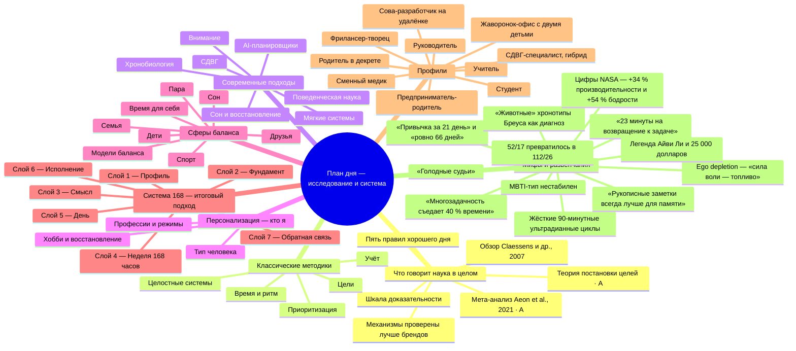
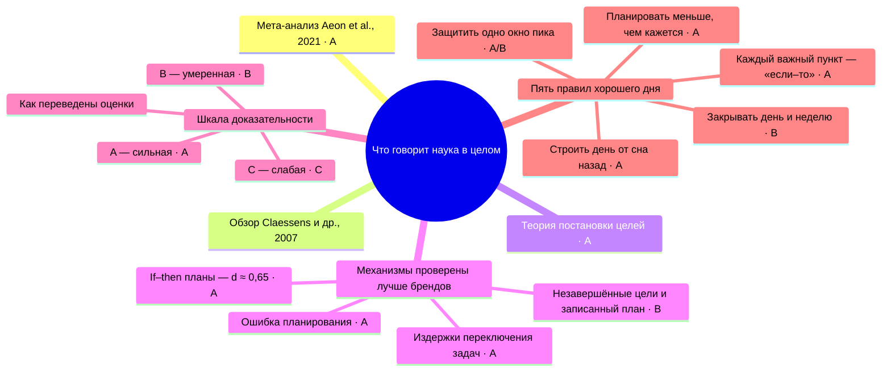
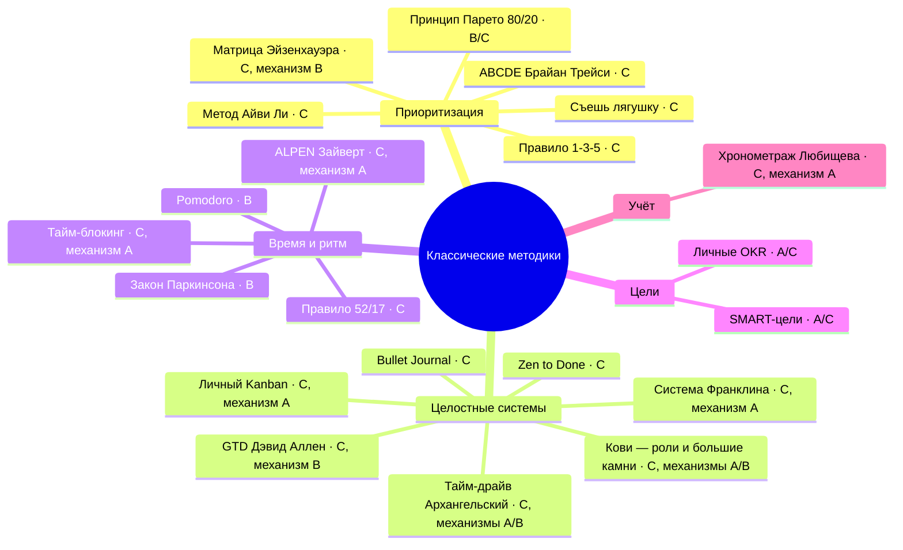
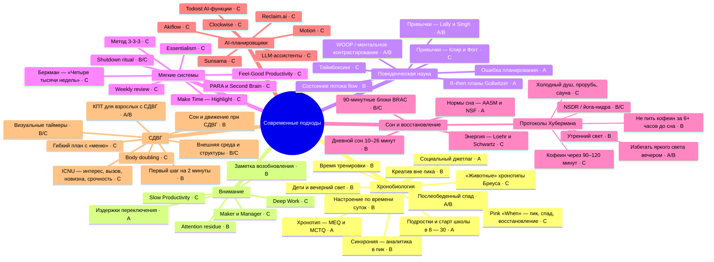
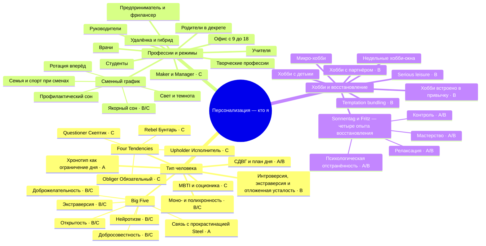
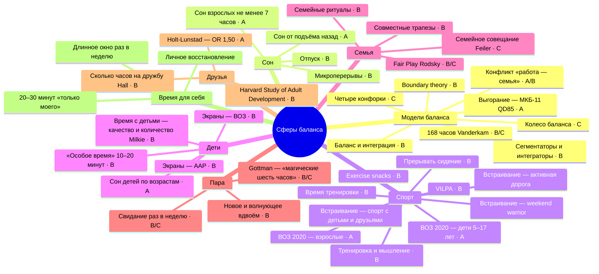
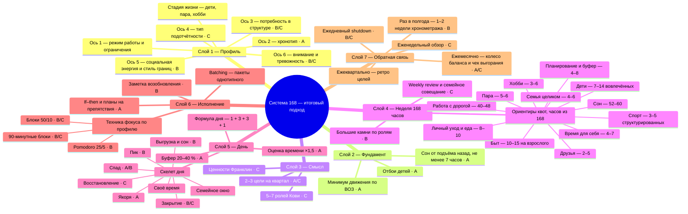
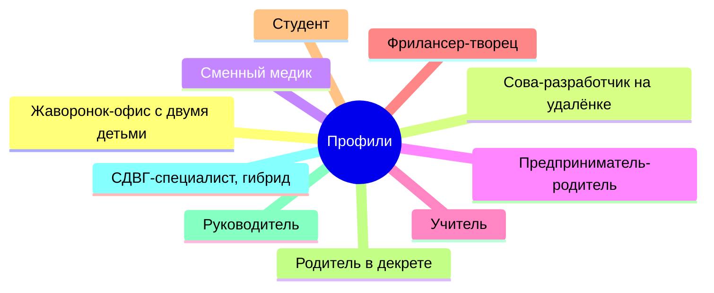
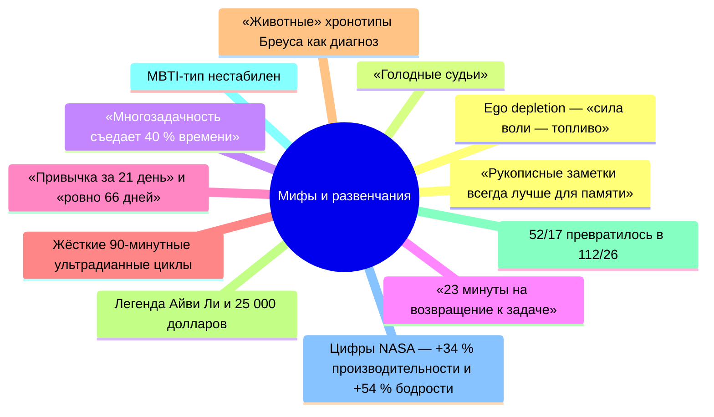

# Ментальная карта: план на день по типу человека, профессии, хобби и балансу работа / спорт / семья / дети

Карта собирает три исследовательских файла в одно дерево: [классические методики](research/01_classic_methods.md), [современная наука](research/02_modern_science.md) и [персонализация и баланс](research/03_personalization_balance.md). В ней 296 узлов, из них 246 листьев с описанием, способом применения и источником. Факты и цифры взяты только из этих файлов.

Интерактивная версия с поиском, фильтром по доказательности и карточками узлов: [mindmap.html](mindmap.html). Ниже та же карта в виде диаграмм Mermaid: сначала обзор, затем отдельная диаграмма на каждую из восьми ветвей.

**Как читать метки.** После названия узла стоит уровень доказательности: **A** сильная, **B** умеренная, **C** слабая. Смешанные оценки записаны как есть (например, A/B). Узел без метки не имеет оценки в источнике. Оценки «сильная / средняя / слабая» из файлов 01 и 03 приведены к A / B / C.

## Обзор

## 1. Что говорит наука в целом

Общий научный фон: метаанализ Aeon 2021, проверенные механизмы, шкала A/B/C и пять правил построения дня. Узлов в ветви: 20.

## 2. Классические методики

21 классическая методика в пяти группах: приоритизация, целостные системы, время и ритм, цели, учёт. Узлов в ветви: 27.

## 3. Современные подходы

Хронобиология, внимание, поведенческая наука, мягкие системы, сон и восстановление, AI-планировщики, СДВГ. Узлов в ветви: 66.

## 4. Персонализация: кто я

Типология человека (Big Five, MBTI, Four Tendencies, хронотип, СДВГ), профессии и режимы, хобби и восстановление. Узлов в ветви: 49.

## 5. Сферы баланса

Модели баланса, сон, спорт, дети, семья, пара, друзья и время для себя. Узлов в ветви: 49.

## 6. Система 168

Итоговый системный подход: семь слоёв, порядок важен. Включает ориентиры недельных квот. Узлов в ветви: 60.

## 7. Профили

Десять типовых профилей: ключевая идея дня и стек методик. Узлов в ветви: 11.

## 8. Мифы и развенчания

Что не подтвердилось или оказалось неточно процитировано, с цифрами. Узлов в ветви: 13.

## Легенда доказательности

| Метка | Уровень | Что означает | Как получена на карте |
|---|---|---|---|
| A | Сильная | Мета-анализы, многоцентровые preregistered-исследования, официальные консенсусы (ВОЗ, AASM, AAP), устойчивые физиологические закономерности | В файлах 01 и 03 «сильная» |
| B | Умеренная | Отдельные RCT и лабораторные эксперименты, обзоры с противоречиями, крупные наблюдательные исследования без доказанной причинности | В файлах 01 и 03 «средняя» |
| C | Слабая | Популярные книги, авторские системы, экспертное мнение, косвенная или отсутствующая база; не значит «бесполезно» | В файлах 01 и 03 «слабая» |
| A/B, B/C, A/C | Смешанная | Оценка зависит от аспекта: например, «слабая или средняя» записана как B/C, «сильная для теории целей, слабая для акронима» как A/C | Оставлена как в источнике |
| без метки | Нет оценки | В источнике оценка для узла не дана (шаблоны профессий, квоты, профили) | Не придумывалась |
| Ветвь «Мифы» | Развенчание | Утверждения, которые не подтвердились или цитируются неточно | Метка A/B/C не ставится |

**Правило для методик.** Если методику целиком не проверяли, она получает C, а уровень механизма, на котором она стоит, указан рядом («C, механизм A»). Так оценены GTD, Кови, Франклин, тайм-блокинг, ALPEN, Kanban и другие; та же шкала используется в [REPORT.md](REPORT.md).

## Ссылки

- Интерактивная карта: [mindmap.html](mindmap.html)
- Полный отчёт: [REPORT.md](REPORT.md)
- Источники карты: [01_classic_methods.md](research/01_classic_methods.md), [02_modern_science.md](research/02_modern_science.md), [03_personalization_balance.md](research/03_personalization_balance.md)
