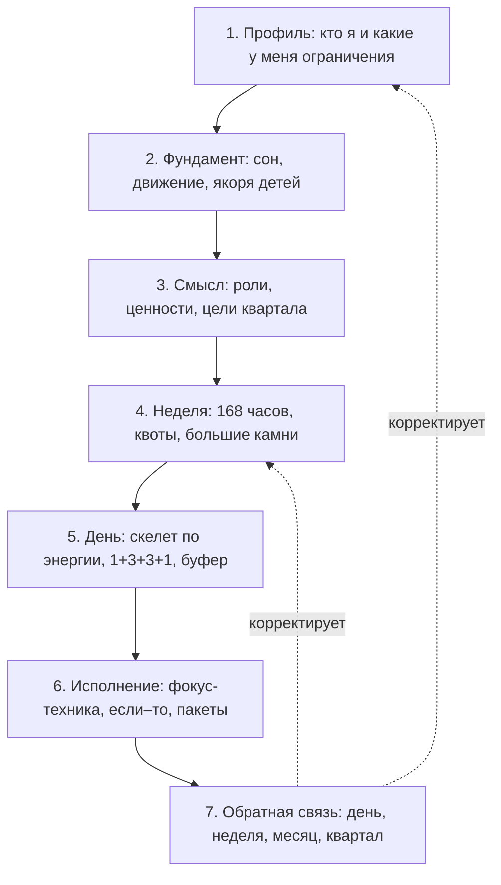
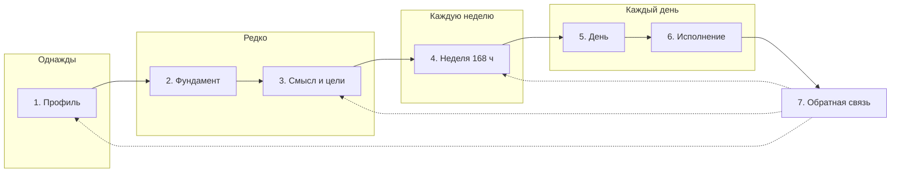
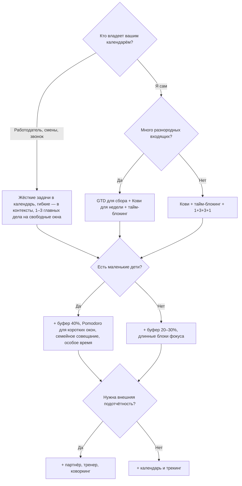

# План дня, который работает: исследование методик и системный подход

> **О чём отчёт.** Как составить хороший план на день с учётом типа человека, профессии и хобби и при этом равномерно распределить время между работой, спортом, семьёй и детьми. Разобраны классические и современные методики, научные данные о персонализации и балансе. Итог — собственная система **«Система 168»**: от профиля человека до ежедневного плана и циклов пересмотра.
>
> **Как готовился.** Три независимых исследовательских направления (классика, современная наука, персонализация и баланс), около 70 методик и концепций, свыше 100 источников. Ключевые цифры проверены по первоисточникам или надёжным вторичным источникам. Что проверить не удалось, помечено в приложениях словом «сверить».
>
> **Дата:** октябрь 2026.
>
> **Связанные файлы:**
> - [MINDMAP.md](MINDMAP.md) — ментальная карта исследования (Mermaid, открывается на GitHub);
> - [mindmap.html](mindmap.html) — интерактивная версия карты (поиск, фильтр по доказательности, карточки методик);
> - [research/01_classic_methods.md](research/01_classic_methods.md) — подробный разбор 21 классической методики;
> - [research/02_modern_science.md](research/02_modern_science.md) — современные научные подходы (хронобиология, внимание, привычки, сон, AI, СДВГ);
> - [research/03_personalization_balance.md](research/03_personalization_balance.md) — типология человека, профессии, хобби, спорт, семья, дети, недельные квоты.

---

## Содержание

0. [Коротко: главное на одной странице](#0-коротко-главное-на-одной-странице)
1. [Как читать отчёт: шкала доказательности](#1-как-читать-отчёт-шкала-доказательности)
2. [Что наука говорит о планировании в целом](#2-что-наука-говорит-о-планировании-в-целом)
3. [Обзор методик: что существует](#3-обзор-методик-что-существует)
4. [Персонализация: от чего зависит хороший план](#4-персонализация-от-чего-зависит-хороший-план)
5. [Сферы жизни: нормы и ориентиры для баланса](#5-сферы-жизни-нормы-и-ориентиры-для-баланса)
6. [Система 168: системный подход](#6-система-168-системный-подход)
7. [Матрица подбора: профиль → набор методик](#7-матрица-подбора-профиль--набор-методик)
8. [Готовые шаблоны дня для 10 профилей](#8-готовые-шаблоны-дня-для-10-профилей)
9. [Внедрение за 12 недель](#9-внедрение-за-12-недель)
10. [Мифы и типичные ошибки](#10-мифы-и-типичные-ошибки)
11. [Шаблоны для копирования](#11-шаблоны-для-копирования)
12. [Инструменты: бумага, приложения, AI](#12-инструменты-бумага-приложения-ai)
13. [Ограничения исследования](#13-ограничения-исследования)
14. [Ключевые источники](#14-ключевые-источники)

---

## 0. Коротко: главное на одной странице

**Семь выводов исследования**

1. **Планирование в первую очередь даёт спокойствие, и только во вторую — продуктивность.** Крупнейший метаанализ (Aeon, Faber & Panaccio, 2021; 158 исследований, около 54 тыс. человек) показал, что тайм-менеджмент сильнее связан с удовлетворённостью жизнью и меньшим стрессом, чем с рабочими результатами. Поэтому баланс работы, семьи и спорта — не «приятное дополнение» к плану, а его главный смысл.
2. **Проверены механизмы, а не бренды.** Почти ни одну методику (GTD, Кови, Bullet Journal) не проверяли целиком. Зато хорошо подтверждены механизмы, на которых они построены:
   - конкретное «если–то, когда и где» (d ≈ 0,65);
   - записанный план, который снимает навязчивые мысли о незавершённом;
   - систематическая недооценка времени на задачи (ошибка планирования);
   - издержки переключения между задачами.

   Хорошая система собирает эти механизмы, название методики вторично.
3. **Баланс считается за неделю, а не за день.** Сбалансировать каждый день по всем сферам невозможно. 168 часов недели — правильная единица (Vanderkam, 2010; Кови, 1989).
4. **Сначала ограничения, потом психология.** Шаблон дня задают профессия и режим (смены, уроки, встречи, детский сад), возраст детей и хронотип. Тип личности определяет не *что* делать, а *как* удерживать план: сколько структуры, какая подотчётность, какой размер списка.
5. **День строится от сна назад.** Взрослым нужно не меньше 7 часов сна (AASM, уровень A), детям — по возрастным нормам. Время отбоя детей — якорь семейного вечера.
6. **Качество времени с детьми важнее количества.** Для детей 3–11 лет количество материнского времени почти не связано с их развитием, важнее стресс и ресурс родителя (Milkie et al., 2015). Работают регулярные короткие ритуалы:
   - 10–20 минут «особого времени» с каждым ребёнком;
   - 3 и больше общих приёма пищи в неделю;
   - еженедельное семейное совещание.
7. **Планируйте меньше, чем кажется возможным.** Множитель ×1,5 к оценкам времени, буфер 20–40 % дня, 1 главное дело в пиковые часы. Внедряйте по одному элементу раз в 2–3 недели.

**Система 168 в одной схеме**



---

## 1. Как читать отчёт: шкала доказательности

Каждой методике и рекомендации присвоен уровень доказательности.

| Уровень | Что значит | Примеры |
|---|---|---|
| **A** — сильная | Метаанализы, многоцентровые исследования, официальные консенсусы (ВОЗ, AASM, AAP) | Нормы сна, рекомендации ВОЗ по активности, «если–то»-планы, ошибка планирования |
| **B** — средняя | Отдельные эксперименты, крупные наблюдательные исследования, проверен механизм, но не методика целиком | Pomodoro-перерывы, послеобеденный спад, ритуал закрытия дня, модель восстановления Sonnentag & Fritz |
| **C** — слабая | Популярные книги, авторские системы, корпоративная аналитика, опыт практиков | GTD, Кови, Bullet Journal, 3-3-3, Four Tendencies, AI-планировщики |

**Уровень C не значит «бесполезно».** Многие популярные системы удачно упаковывают механизмы уровня A и B. Плохо только выдавать их за «доказанные наукой».

---

## 2. Что наука говорит о планировании в целом

### 2.1. Общая картина

- **Aeon, Faber & Panaccio (2021), *PLOS ONE*.** Метаанализ 158 исследований. Тайм-менеджмент умеренно связан с результативностью и сильнее — с благополучием и меньшим дистрессом. Из черт личности заметную роль играет только добросовестность. Связь с рабочей эффективностью со временем усиливается: у людей стало больше автономии в распоряжении временем.
- **Claessens et al. (2007), *Personnel Review*.** Обзор 32 исследований: тайм-менеджмент связан с ощущением контроля над временем, удовлетворённостью работой и здоровьем. Тренинги улучшают навыки, но в результат это **не переходит автоматически**. Внедрять нужно постепенно и с обратной связью.

### 2.2. Восемь проверенных механизмов, на которых стоят методики

| Механизм | Что показано | Доказательность | Какие методики используют |
|---|---|---|---|
| **Намерения реализации («если–то»)** | Конкретное «когда, где, что» повышает шанс выполнения; метаанализ 94 тестов, d ≈ 0,65 (Gollwitzer & Sheeran, 2006) | A | Тайм-блокинг, таймбоксинг, жёсткие задачи Архангельского, ALPEN, привязка привычек |
| **Записанный план снимает «открытые петли»** | Незавершённые цели мешают думать о другом, конкретный план снимает этот эффект (Masicampo & Baumeister, 2011) | B | GTD, Айви Ли, Bullet Journal, ритуал закрытия дня |
| **Ошибка планирования** | Люди систематически недооценивают время: студенты прогнозировали 33,9 дня на диплом, потратили 55,5 (Buehler et al., 1994) | A | Буферы ALPEN, хронометраж, множитель ×1,5 |
| **Издержки переключения** | Каждое переключение стоит времени, тем больше, чем сложнее задачи (Rubinstein et al., 2001) | A (явление) | Пакетирование, WIP-лимит Kanban, Deep Work, однозадачность |
| **Остаток внимания** | Часть внимания «залипает» на прерванной задаче; 1–2 минуты записи «где остановился» снижают эффект (Leroy, 2009; Leroy & Glomb, 2018) | B | Заметка возобновления, shutdown ritual |
| **Эффект мнимой срочности** | Люди выбирают задачи, которые лишь выглядят срочными, даже в ущерб большей награде (Zhu, Yang & Hsee, 2018) | B | Матрица Эйзенхауэра, квадрант II Кови |
| **Теория постановки целей** | Конкретные и трудные цели дают лучший результат, чем «сделай как можно лучше» (Locke & Latham, 1990, 2002) | A | SMART, OKR, пирамида Франклина |
| **Самонаблюдение** | Мониторинг прогресса улучшает достижение целей, особенно если результаты записываются (Harkin et al., 2016) | A | Хронометраж Любищева, трекеры, вечерний контроль |

### 2.3. Что не подтвердилось

- **«Истощение силы воли» (ego depletion).** Две крупные многоцентровые проверки не нашли эффекта: Hagger et al. (2016), d = 0,04; Vohs et al. (2021), d = 0,06. Совет «предрешай рутинные выборы» остаётся полезным, но потому что экономит время и переключения, а не «запас воли».
- **Подробнее о мифах** — в [разделе 10](#10-мифы-и-типичные-ошибки).

---

## 3. Обзор методик: что существует

### 3.1. Классические методики

| Методика | Суть в одной строке | Горизонт | Доказательность | Лучше всего для |
|---|---|---|---|---|
| **Метод Айви Ли** (1918, легенда) | Вечером ≤ 6 дел на завтра по важности, делать строго по порядку | День | C (механизм — B) | Новичков, руководителей, «не знаю, с чего начать» |
| **Матрица Эйзенхауэра** | Важное/срочное, 4 квадранта; защищать важное несрочное | День, неделя | B | Тех, кто тонет в «пожарах»; родителей |
| **ABCDE** (Трейси, 2001) | Буквы по последствиям; D — делегировать, E — убрать | День | C | Длинных списков, обучения делегированию |
| **«Съешь лягушку»** (Трейси) | Самое трудное — первым | День | C/B | Прокрастинаторов; лучше «в свой пик», а не обязательно утром |
| **Принцип Парето 80/20** | Немногие задачи дают основную ценность | Неделя | B (явление) / C (применение) | Предпринимателей, перфекционистов |
| **Закон Паркинсона** | Работа занимает всё отведённое время, поэтому задаче нужна рамка | Задача | B | Фрилансеров, студентов |
| **Система Франклина** | Ценности → цели → задачи дня | Жизнь → день | B (косвенно) | Поиска смысла и баланса ценностей |
| **Кови, «7 навыков»** (1989) | Роли, «большие камни» в календарь первыми, планировать неделю | Неделя, жизнь | B (косвенно) | **Баланса работа / семья / спорт** |
| **GTD** (Аллен, 2001) | Всё из головы в систему, контексты, следующее действие, недельный обзор | День, неделя | B (теория + механизмы) | Большого потока входящих |
| **Pomodoro** (Чирилло) | 25 мин фокуса + 5 мин перерыва | Час | B (Biwer et al., 2023) | Старта, неприятных задач, коротких окон |
| **Тайм-блокинг** | Каждому отрезку дня — свой тип работы | День, неделя | B/A (механизм «если–то») | Удалёнщиков, защиты семьи и спорта |
| **Bullet Journal** (Кэрролл, 2013) | Бумажная модульная система с миграцией | День, месяц | C | Любителей бумаги и рефлексии |
| **Личный Kanban** (Benson, 2011) | Доска + лимит задач в работе | Поток | B (механизм) | Визуалов, семейных досок |
| **ALPEN** (Зайверт) | Задачи → длительность → буфер 40 % → решения → контроль | День | B (механизм) | Хронически «не успевающих», родителей |
| **1-3-5** | 1 большая, 3 средние, 5 мелких задач | День | C | Офисного дня, новичков |
| **Хронометраж Любищева** | Учёт фактического времени | Диагностика | B (самонаблюдение) | Калибровки оценок, «куда уходит время» |
| **Тайм-драйв** (Архангельский, ~2005) | Жёсткие, гибкие, бюджетируемые задачи; контексты; «слоны» и «лягушки» | Жизнь → день | B (косвенно) | Русскоязычных менеджеров, родителей |
| **SMART** (Doran, 1981) | Критерии формулировки цели | Цели | A (теория) / C (акроним) | Спортивных, учебных, финансовых целей |
| **Личные OKR** | Цель + 2–4 измеримых результата на квартал | Квартал | C (личн.) / A (теория целей) | Амбициозных, семейных проектов |
| **52/17** (DeskTime, 2014) | 52 мин работы + 17 мин отдыха | Час | C (в 2021 те же данные дали 112/26) | Тем, кому мало 25 минут |
| **Zen to Done** (Бабаута) | Упрощённый GTD, 3 главных задачи в день, по одной привычке за раз | День, неделя | C/B | Новичков, «сломавшихся» на GTD |

Подробно, с пошаговым применением и ограничениями, — в [research/01_classic_methods.md](research/01_classic_methods.md).

### 3.2. Современные научные и популярные подходы

| Подход | Что даёт для плана дня | Доказательность | Кому особенно |
|---|---|---|---|
| **Хронотип** (MEQ, MCTQ) и **социальный джетлаг** | Когда ставить сложное; подъём в выходные ±1 ч от будней | A (явление) / B (польза подстройки) | Гибкий график, «совы», подростки |
| **«Животные» Бреуса** (лев, медведь, волк, дельфин) | Понятный язык для семьи | C | Только как ярлык; «дельфинам» — к сомнологу |
| **Синхрония и «инсайт не в пик»** | Аналитика — в пик, креатив — вне пика | B | Умственный труд, люди 50+ |
| **Послеобеденный спад** (Monk, 2005) | 13–16 ч — рутина, встречи, движение, короткий сон | A/B | Все |
| **Пик → спад → восстановление** (Pink, 2018) | Три зоны дня под три типа задач | C (на основе B) | Офис, учителя, студенты |
| **Сдвиг фазы у подростков**, AAP: школа не раньше 8:30 | Не ставить подростку сложное рано; приглушать свет вечером | A | Семьи с подростками |
| **Блоки 60–90 минут** | Размер глубокого блока; 2–4 ч глубокой работы в день — потолок | B/C | Глубокая работа |
| **Энергия, а не время** (Loehr & Schwartz, 2003) | Точки восстановления, 4 вида энергии | C | Руководители, родители |
| **Deep Work** (Newport, 2016) | Защищённый блок 2–4 ч | C (механизмы A/B) | IT, наука, письмо |
| **Slow Productivity** (Newport, 2024) | ≤ 3 активных проекта; квартал → неделя → день | C | Перегруженные специалисты |
| **Maker vs Manager** (Graham, 2009) | Встречи пакетом, утра без встреч | C | Команды, программисты |
| **WOOP / MCII** (Oettingen) | Желание → результат → препятствие → план; метаанализ g = 0,34 | A/B | Цели с внутренними барьерами |
| **Привычки** (Lally, 2010; Singh, 2024; Клир; Фогг) | Якоря, крошечный старт; медиана 59–66 дней, разброс 4–335 | A/B (принципы) / C (авторские системы) | Спорт, здоровье, хобби |
| **Таймбоксинг** (Eyal, 2019) | Календарь от ценностей: «я», «отношения», «работа» | C (механизм A) | Баланс работа / семья |
| **Flow** (Чиксентмихайи) | Ясная цель блока, посильная сложность; активные хобби | B | Творческие, спорт, хобби |
| **«Четыре тысячи недель», 3-3-3** (Беркман) | Принять конечность; 3 ч фокуса + 3 коротких + 3 поддерживающих дела | C | Перегруженные, перфекционисты |
| **Essentialism** (McKeown, 2014) | «Чёткое да или нет», буферы | C | Руководители |
| **Highlight** (Knapp & Zeratsky, 2018) | Одно главное дело дня в календаре | C | Занятые родители |
| **Feel-Good Productivity** (Abdaal, 2023) | Игра, сила, люди как источники энергии | C | Выгорающие, студенты |
| **Ритуал закрытия дня** (Newport) + список на завтра | Граница работа/семья; засыпание примерно на 9 мин быстрее (Scullin et al., 2018) | B (механизм) / C (ритуал) | Удалёнщики, родители |
| **Недельный обзор** (GTD, Newport) | Связь недели с днём, координация семьи | C | Все |
| **PARA** (Forte, 2022) | Инфраструктура проектов и сфер жизни | C | Знаниевые работники |
| **Нормы сна** (AASM, NSF) | План строится от сна назад | A | Все |
| **Утренний свет, вечерний полумрак** | Утренняя прогулка, тёплый свет вечером | B (механизм A) | «Совы», подростки, дети |
| **Дневной сон 10–26 мин** (NASA, 1994–95) | Перезагрузка в спад | B | Сменщики, родители младенцев |
| **NSDR, йога-нидра** | 10–20 мин восстановления днём | B/C | Кто не может спать днём |
| **AI-планировщики** (Motion, Reclaim, Sunsama…) | Автоматизация таймбоксинга и защиты блоков | C (независимых исследований нет) | Много проектов и встреч |
| **СДВГ-приёмы** (КПТ, таймеры, body doubling) | Сделать время видимым, внешняя структура | B (КПТ) / C (отдельные приёмы) | СДВГ, дети, прокрастинаторы |

Подробно — в [research/02_modern_science.md](research/02_modern_science.md).

### 3.3. Методики не конкурируют: они отвечают на разные вопросы

Почти все противоречия между методиками исчезают, если разложить их по уровням.

| Уровень | Вопрос | Методики |
|---|---|---|
| 1. Смысл | Зачем? Что для меня важно? | Франклин, миссия и роли Кови, личная стратегия Архангельского, «Четыре тысячи недель» |
| 2. Цели | К чему конкретно иду в этом квартале? | SMART, личные OKR, Парето, WOOP |
| 3. Неделя | Какие «большие камни» на этой неделе? | Недельный план Кови, недельный обзор GTD, 168 часов Vanderkam, multi-scale planning |
| 4. Сбор | Где лежит всё, что нужно сделать? | GTD, PARA, Bullet Journal, бэклог Kanban |
| 5. Приоритет дня | Что именно сегодня? | Эйзенхауэр, ABCDE, Айви Ли, 1-3-5, 3-3-3, Highlight, «лягушка» |
| 6. Размещение | Когда и сколько? | Тайм-блокинг, таймбоксинг, жёсткие/гибкие задачи, ALPEN, хронотип, пик–спад–восстановление |
| 7. Выполнение | Как не отвлечься и не устать? | Pomodoro, 52/17, блоки 60–90 мин, WIP-лимит, «если–то», заметка возобновления |
| 8. Обратная связь | Что произошло на самом деле? | Хронометраж, вечерний контроль ALPEN, ритуал закрытия, колесо баланса |

### 3.4. Удачные сочетания и как снять конфликты

**Сочетания, которые хорошо работают:**
- **Кови + тайм-блокинг + короткий список дня + Pomodoro + вечерний контроль** — «сбалансированный стек» для большинства людей с семьёй и работой. Баланс задаётся неделей, день остаётся простым.
- **GTD + Кови или Франклин.** GTD хорошо ловит и обрабатывает входящее, но не отвечает на вопрос «зачем».
- **Жёсткие задачи в календаре + гибкие в контекстных списках** (Архангельский + GTD). Особенно удобно родителям: «окна» на площадке или в очереди становятся полезными.
- **ALPEN + хронометраж.** Хронометраж даёт реальные длительности для шага «оценить время».

**Конфликты и их разрешение:**

| Конфликт | Разрешение |
|---|---|
| GTD («выбирай по контексту») против списка на день (Айви Ли, 1-3-5) | Короткий список «обязательно сегодня» (3–6 пунктов) поверх контекстных списков |
| Тайм-блокинг (расписание) против Kanban (поток) | Блокировать **типы работы** («глубокая работа 9–11»), конкретную задачу брать из списка |
| Pomodoro против состояния потока | Pomodoro — для старта и рутины, длинные блоки — для глубокой работы; поток таймером не прерывать |
| «Съешь лягушку утром» против хронотипа и утренних сборов детей | «Лягушка» — в первое защищённое окно и в свой пик |
| Закон Паркинсона (сжимать) против буфера ALPEN (расширять) | Сжимать отдельные задачи, буфер держать на уровне дня |
| SMART «реалистично» против OKR «амбициозно» | SMART — для привычек и обязательного (здоровье, дети, финансы), OKR — для развития и проектов |
| Слишком много систем сразу | Один новый элемент раз в 2–4 недели |

---

## 4. Персонализация: от чего зависит хороший план

Универсального «идеального дня» не существует. План строится в три слоя:
1. **Жёсткие ограничения:** профессия, график, дорога, возраст детей.
2. **Биология:** хронотип, потребность во сне, особенности внимания.
3. **Психология:** сколько нужно структуры, как человек реагирует на обязательства, склонность к тревоге и прокрастинации.

### 4.1. Шесть осей профиля

| # | Ось | Как определить | Что меняет в плане |
|---|---|---|---|
| 1 | **Режим работы и ограничения** | Кто владеет вашим календарём? Есть ли смены, звонки, встречи, дежурства? | Каркас дня: где жёсткие блоки, где свободные окна, какой нужен буфер |
| 2 | **Хронотип** | Опросники MEQ или MCTQ; как вы спите в отпуске без будильника (середина сна до ~3:00 — ранний тип, после ~5:00 — поздний) | Когда ставить сложное (пик), рутину (спад), креатив (восстановление) |
| 3 | **Потребность в структуре** | Добросовестность (Big Five), предпочтение J/P, монохронность или полихронность | Подробное расписание или «меню» задач с 2–3 якорями |
| 4 | **Тип подотчётности** | Four Tendencies (Rubin, 2017): Исполнитель, Скептик, Обязательный, Бунтарь | Чем удерживать план: календарём, данными, внешними обязательствами или свободой выбора |
| 5 | **Социальная энергия и границы** | Интроверсия или экстраверсия; сегментатор (жёсткие границы ролей) или интегратор | Окна восстановления после общения; ритуалы перехода; как совмещать работу и семью |
| 6 | **Внимание и тревожность** | Нейротизм; признаки СДВГ (оценку ставит специалист) | Длина списка, размер блоков, внешние опоры, вечерняя выгрузка мыслей |

Плюс **стадия жизни**: возраст детей, есть ли партнёр, сколько хобби.

### 4.2. Как адаптировать план под тип личности

**Big Five** — самая научно состоятельная модель личности. Прокрастинацию сильнее всего предсказывают низкая добросовестность, импульсивность и неприятность задачи; нейротизм — лишь слабо (Steel, 2007, метаанализ).

| Черта | Высокий полюс | Низкий полюс |
|---|---|---|
| **Добросовестность** | Подробные планы работают сами. Риск — перегрузка и перфекционизм: обязательны буфер 20–30 % и защищённые блоки отдыха | Минимум структуры, максимум внешних опор: 1–3 главные задачи, «если–то», таймер, внешняя подотчётность, горизонт — день и неделя |
| **Нейротизм** | Короткий список, вечерняя выгрузка мыслей, план на завтра с вечера, тяжёлые задачи режутся на маленькие первые шаги | Плотные планы переносятся легко. Риск — не заметить усталость, поэтому нужен еженедельный чек-ин |
| **Экстраверсия** | Работа с людьми, групповые тренировки, подотчётность через друзей. Не ставить сложную аналитику сразу после насыщенного общения | Встречи кластерами в 1–2 дня, 15–30 мин тишины после длинных совещаний, индивидуальный спорт |
| **Открытость** | Новизна: «тематические дни», эксперименты недели, смена места работы | Стабильный распорядок, чек-листы, повторяющиеся шаблоны |
| **Доброжелательность** | Риск — говорить «да» всем. Защищённые блоки «встреча с собой», правило «отвечу завтра» | Меньше проблем с отказами; полезны явные договорённости в семье |

**Важная деталь про энергию общения.** Экстравертное поведение у всех людей сразу поднимает настроение, но через 2–3 часа сопровождается усталостью (Leikas & Ilmarinen, 2017). После 2–3 часов интенсивного общения (совещания, уроки, приём пациентов, детский праздник) нужно окно восстановления 15–30 минут.

**Four Tendencies** (Rubin, 2017; доказательность C, но полезна как язык для подотчётности):

| Тенденция | Что делать |
|---|---|
| **Исполнитель** (~19 %) | Чёткое расписание и чек-листы; заранее разрешить себе отклонения |
| **Скептик** (~24 %) | Каждому блоку — «зачем»: данные, трекинг, эксперименты; дедлайн на «исследование вариантов» |
| **Обязательный** (~41 %) | **Внешняя подотчётность обязательна**: тренер, партнёр по пробежке, коворкинг, обещание детям. «Время для себя» оформлять как обязательство перед кем-то |
| **Бунтарь** (~17 %) | Меню выбора вместо расписания, формулировки через идентичность («я человек, который двигается»), челленджи |

Проценты — из опроса самой Рубин, рецензируемой валидации нет.

**MBTI и соционика.** Четырёхбуквенный тип часто меняется при повторном тесте, хотя отдельные шкалы стабильнее (доказательность C). Шкалу J/P можно использовать только как язык для разговора о том, сколько структуры нужно человеку: «J» — подробный план и тайм-блокинг; «P» — список приоритетов без привязки ко времени плюс 2–3 якоря в день.

**Монохронность и полихронность** (Hall; Bluedorn et al., 1999). Монохронным подходят тайм-блокинг и одна задача на блок. Полихронным — «тематические окна» (например, «клиенты и переписка 9–12», внутри можно переключаться между похожими делами) и короткие защищённые спринты на 45–60 минут для глубокой работы. Многозадачность когнитивно затратна для всех, это предпочтение, а не способность.

**СДВГ** (у взрослых около 2,6 % — стойкий, около 6,8 % — симптоматический; Song et al., 2021). Самые надёжные данные у КПТ, которая учит навыкам планирования. Практические опоры: видимые таймеры, визуальный план на бумаге, короткие блоки 15–25 минут, работа рядом с другим человеком (body doubling, доказательность C), ×1,5 к оценкам времени, жёсткие якоря дня при гибком «меню» задач. План дня не заменяет диагностику и лечение.

### 4.3. Профессия и режим работы

| Режим | Главные ограничения | Ключевые решения в плане |
|---|---|---|
| **«Мейкер»** (разработчик, дизайнер, писатель, исследователь) | Встреча посреди утра ломает весь блок | Встречи кластером (например, после 14:00), блоки глубокой работы 2–4 ч, дни без встреч |
| **«Менеджер», руководитель** | День из коротких эпизодов, постоянная доступность | Утренний стратегический блок 30–90 мин до встреч; встречи по 25/50 минут вместо 30/60; правила доступности вечером |
| **Офис 9–18** | Дорога, open space, совещания | Движение утром или «активная дорога»; глубокая работа до обеда; ритуал закрытия дня как переход к семье |
| **Удалёнка, гибрид** | Размытые границы, сидячий образ жизни, изоляция | «Ложная дорога на работу» (прогулка 15–20 мин); фиксированное время окончания; движение каждые 60–90 мин; офисные дни — под встречи, домашние — под глубокую работу |
| **Сменная работа, ночные смены** | Сбитые циркадные ритмы, недосып, ротация | Якорный сон (~4 ч в одно и то же время каждый день); профилактический сон перед ночью; яркий свет в начале смены, тёмные очки по дороге домой; планирование по циклу смен, а не по дням недели; ротация «вперёд» (утро → день → ночь) |
| **Предприниматель, фрилансер** | Нет внешней структуры, работа «съедает всё» | Искусственные рамки начала и конца дня; лимит часов (например, ≤ 50 в неделю); день «стратегии и финансов»; внешняя подотчётность |
| **Творческая профессия** | Непредсказуемость, авралы | Ежедневная практика в пик хронотипа; сезонное планирование: интенсив сменяется восстановлением; хобби другой модальности |
| **Врач** | Жёсткий график, дежурства, эмоциональная нагрузка | Микровосстановление между пациентами (1–2 мин); защищённый сон после дежурства; короткие интенсивные тренировки; общий семейный календарь дежурств |
| **Учитель** | Звонок задаёт ритм, проверка работ «съедает» вечера | Спорт до школы или сразу после уроков; проверка работ в фиксированном блоке (например, 15–16:30 в школе); окно тишины после уроков |
| **Студент** | Хаотичный график, сессии, часто поздний хронотип | Подъём ±1 ч каждый день; учебные блоки 50–90 мин; групповой спорт; без ночных «штурмов» |
| **Родитель в декрете** | День задаёт ребёнок, рваный сон, изоляция | План по окнам сна ребёнка, а не по часам; одно дело на окно; прогулка с коляской = спорт + свет + люди; ночные дежурства пополам с партнёром |

### 4.4. Хобби: как они восстанавливают и как их встроить

**Модель восстановления** (Sonnentag & Fritz, 2007; доказательность B). Нерабочее время восстанавливает через четыре опыта:
1. **Отстранённость** — не думать о работе.
2. **Релаксация** — низкая активация, телесное расслабление.
3. **Мастерство** — вызов и рост вне работы.
4. **Контроль** — самому решать, что делать.

Хорошее хобби даёт хотя бы два из четырёх. Хобби, похожее на работу (программист пишет pet-проект), даёт мастерство, но не отстранённость. Его стоит дополнять хобби другой природы: физическим, ручным, на природе.

**Правила встраивания хобби:**
- В неделе нужны оба вида досуга: **лёгкий** (отдых, сериалы) и **«серьёзный»** — систематическое занятие с ростом, сообществом и идентичностью (Stebbins, 1982). Реалистично 1–2 серьёзных хобби на этап жизни.
- Серьёзному хобби нужен **регулярный слот**: например, два вечера по 60–90 минут и один длинный блок в выходные.
- **Привязка** к существующей привычке: «после того как уложил детей — 20 минут гитары».
- **Объединение приятного с полезным** (Milkman et al., 2014): подкаст только на беговой дорожке.
- **Хобби с детьми и партнёром** экономит время (походы, велосипед, настольные игры, готовка). Но хотя бы одно хобби должно быть **только своим**: в совместном взрослый часто организатор, а не участник.
- **Микрохобби** для очень загруженных (декрет, руководители): 10–15 минут в день лучше, чем ничего.
- **Партнёры прикрывают друг друга:** «я с детьми во вторник, ты — в четверг».

---

## 5. Сферы жизни: нормы и ориентиры для баланса

### 5.1. Нормы, на которые можно опираться

| Сфера | Норма или ориентир | Доказательность | Источник |
|---|---|---|---|
| **Сон взрослых** | ≥ 7 ч регулярно (7–9 ч по NSF) | A | AASM/SRS, Watson et al., 2015; Hirshkowitz et al., 2015 |
| **Сон детей** (за сутки, с дневным) | 4–12 мес: 12–16 ч; 1–2 года: 11–14 ч; 3–5 лет: 10–13 ч; 6–12 лет: 9–12 ч; 13–18 лет: 8–10 ч | A | AASM, Paruthi et al., 2016 (одобрено AAP) |
| **Физическая активность взрослых** | 150–300 мин умеренной или 75–150 мин интенсивной в неделю + силовые ≥ 2 дней | A | ВОЗ, Bull et al., 2020 |
| **Активность детей 5–17 лет** | В среднем 60 мин в день умеренной и интенсивной; 3 дня в неделю — интенсивная и укрепляющая | A | ВОЗ, 2020 |
| **Короткие всплески активности** | ~3 всплеска по 1–2 мин в день связаны с риском смерти ниже на 38–40 % | B (наблюдательные данные) | Stamatakis et al., 2022 |
| **Время тренировки** | Прирост силы от времени суток не зависит; лучшее время — то, которое удаётся соблюдать | B | Grgic et al., 2019 |
| **Экраны у малышей** | До 1 года — нет; 2–4 года — ≤ 1 ч в день (ВОЗ); до 18 мес — только видеозвонки, 2–5 лет — ≤ 1 ч вместе со взрослым (AAP) | B | ВОЗ, 2019; AAP, 2016 |
| **Время с детьми** | Важнее качество и ресурс родителя; 10–20 мин «особого времени» в день на ребёнка | B | Milkie et al., 2015; родительские программы |
| **Общие приёмы пищи** | ≥ 3 в неделю: шансы на нездоровое питание на 20 % ниже, на расстройства пищевого поведения — на 35 % ниже | B (наблюдательные данные) | Hammons & Fiese, 2011 |
| **Время пары** | ~6 ч в неделю: прощания и встречи, 20 мин разговора о дне, свидание ~2 ч, разговор об отношениях ~1 ч | C/B | Gottman & Silver, 1999 |
| **Социальные связи** | Сильные связи — OR 1,50 для выживания; ~80–100 ч общения, чтобы появился друг | A / B | Holt-Lunstad et al., 2010; Hall, 2019 |
| **Работа** | Хронически ≥ 55 ч в неделю связано с повышенным риском инсульта и ИБС | A/B | ВОЗ/МОТ, Pega et al., 2021 |
| **Глубокая работа** | 2–4 ч в день — реалистичный потолок | C | Newport; Ericsson |

### 5.2. Недельный бюджет: 168 часов

Базовый профиль: взрослый с полной занятостью, в паре, 1–2 ребёнка школьного возраста. Это ориентиры, а не нормы. Цель — распределять время осознанно и пересматривать раз в месяц.

| Сфера | Часов в неделю | В день (≈) | Почему так |
|---|---|---|---|
| Сон | **56** (52–60) | 8 | ≥ 7 ч + время на засыпание; первый блок плана |
| Работа с дорогой | **45** (40–48) | 9 × 5 | Стандартная неделя; ≥ 55 ч — фактор риска |
| Спорт | **4** (3–5) + бытовая активность | 30–40 мин | ВОЗ: 150–300 мин + силовые; активная дорога и игры с детьми засчитываются |
| Дети (вовлечённое время) | **12** (7–14) | 1–2 ч | Уроки, чтение, игры, дорога; особое время с каждым ребёнком |
| Семья целиком | **5** (4–6) | — | ≥ 3 общих приёма пищи, совещание 15–20 мин, совместная активность в выходные |
| Пара | **6** (5–6) | ~50 мин | Ориентир Готтмана |
| Хобби | **4** (3–6) | — | 2 вечера по 60–90 мин или длинный блок в выходные |
| Друзья | **3** (2–5) | — | Регулярный дружеский слот; можно совмещать со спортом |
| Своё время, восстановление | **5** (4–7) | 30–60 мин | Отстранённость, релаксация, контроль; профилактика выгорания |
| Дом и быт | **12** (10–15) | — | Распределять по правилу полного владения задачей (Fair Play) |
| Личный уход, еда | **9** (8–10) | — | — |
| Планирование и буфер | **7** (4–8) | — | Недельный обзор 30–45 мин + 10 мин ежедневно + непредвиденное |
| **Итого** | **168** | | |

**Как менять бюджет под профиль:**
- **Без детей:** часы «детей» и часть «семьи» перераспределяются в друзей (+4), хобби (+4), спорт (+2), пару (+2).
- **Декрет:** работа превращается в уход за ребёнком (60–80 ч, во многом пересекается с бытом). Сон рваный, добирается дневным сном. Минимумы: спорт 2–3 ч (прогулки + 2 короткие силовые), своё время 5 ч, общение 3 ч, пара 3 ч.
- **Сменная работа:** сон считается за 7 дней, а не по ночам (цель — те же 52–60 ч, включая профилактический и якорный сон). Семья и пара — блоками в выходные дни смены.
- **Предприниматель на запуске:** допустим «сезон» 50–55 ч работы на 6–8 недель с жёсткими минимумами: сон ≥ 49 ч, спорт ≥ 2,5 ч, пара ≥ 3 ч, дети ≥ 7 ч, 1 полный выходной. Затем восстановление.
- **Студент:** учёба и работа 40–50 ч, сон 56–63 ч, спорт 4–6 ч, друзья 6–10 ч (возраст формирования социальной сети), хобби 4–8 ч.
- **Учитель, врач:** работа часто 45–55 ч; компенсировать микровосстановлением и защищёнными каникулами и отпуском; восстановление не меньше 5–7 ч в неделю.

### 5.3. Модели баланса: что выбрать

| Модель | Идея | Когда полезна |
|---|---|---|
| **Баланс** (work-life balance) | Равновесие ролей | Как цель-ориентир; плохо, если понимать как «поровну каждый день» |
| **Интеграция и обогащение** (Greenhaus & Powell, 2006) | Роли подпитывают друг друга | Совмещённые активности: спорт с друзьями, хобби с детьми |
| **Теория границ** (Ashforth et al., 2000; Kossek) | Люди — от сегментаторов (жёсткие границы) до интеграторов | **Сегментаторам:** отдельные устройства, жёсткое окончание дня, ритуал закрытия. **Интеграторам:** гибкость (забрать ребёнка в 16:00 и доработать в 20:00), но с «неприкосновенными» блоками: ужин, сон, время пары |
| **«Четыре конфорки»** (Sedaris, 2009) | Семья, друзья, здоровье, работа: всё сразу на полном огне не горит | Регулировать огонь **по сезонам**, а не выключать конфорку навсегда; объединять конфорки |
| **Колесо баланса** (Meyer) | Самооценка 6–10 сфер от 1 до 10 | Ежемесячная диагностика: выбрать 1–2 «просевшие» сферы и дать им блоки в неделе |
| **168 часов** (Vanderkam, 2010) | Баланс считается за неделю | Основа недельного планирования |

**Конфликт работа–семья** (Greenhaus & Beutell, 1985) бывает трёх видов, и на каждый нужен свой инструмент:
- **по времени** — время на одну роль недоступно другой → недельный план и общий семейный календарь;
- **по напряжению** — усталость с работы приходит домой → буфер восстановления 15–20 мин между работой и семьёй, сон, спорт. Дети чаще хотят, чтобы родители были **менее уставшими и напряжёнными**, чем чтобы проводили с ними больше времени (Galinsky, 1999);
- **по поведению** — жёсткость руководителя неуместна дома → осознанный ритуал смены роли.

**Выгорание** (МКБ-11, код QD85) — профессиональный феномен из трёх измерений: истощение, цинизм и дистанцирование, снижение эффективности. Ежемесячно оценивайте три показателя от 1 до 10. Работайте не только с «личной устойчивостью», но и со структурными причинами (нагрузка, контроль, справедливость). При выраженных симптомах — к специалисту.

---

## 6. Система 168: системный подход

Система собирает в одну конструкцию механизмы с лучшей доказательностью и методики, которые подходят для баланса. Название — по числу часов в неделе: **баланс планируется неделей, а исполняется днём**.



**Принципы системы:**
1. **Сначала неприкосновенное, потом остальное.** Сон, якоря детей и минимум движения ставятся в план первыми.
2. **Неделя задаёт баланс, день — исполнение.** День не обязан быть сбалансированным, неделя — обязана.
3. **Энергия важнее часов.** Сложное — в пик, рутина — в спад, восстановление — по плану.
4. **Меньше, чем кажется возможным.** Буфер и множитель ×1,5 к оценкам.
5. **Механика под человека.** Профиль определяет не цели, а способ их удерживать.
6. **Петля обратной связи.** Система корректируется по факту, а не по ощущениям.

### Слой 1. Профиль: кто я

**Когда:** один раз в начале и при больших переменах (новая работа, рождение ребёнка, переезд). **Время:** 1–2 недели наблюдения + 1 час на заполнение.

**Что сделать:**
1. **Хронометраж 1–2 недели** (Любищев, Vanderkam): записывайте фактическое время по сетке 7 дней × 24 часа, включая дорогу, соцсети, детей и спорт. Это даёт реальную картину и калибрует оценки времени.
2. **Хронотип:** пройти MEQ или MCTQ либо записать время сна в выходные без будильника.
3. **Заполнить карточку профиля** ([шаблон в разделе 11](#111-карточка-профиля)) по шести осям из [раздела 4.1](#41-шесть-осей-профиля).
4. **Колесо баланса:** оценить 8 сфер от 1 до 10, отметить 1–2 самые просевшие.

**Результат:** понятно, где жёсткие рамки, когда пик энергии, сколько нужно структуры и что держит в плане.

### Слой 2. Фундамент: неприкосновенное

**Когда:** определяется один раз, пересматривается раз в квартал.

Фундамент — блоки, которые **не двигаются ради работы**. Они вносятся в календарь до всего остального.

| Элемент | Правило | Доказательность |
|---|---|---|
| **Подъём** | Стабильное время ±30–60 мин, в выходные ±1 ч (минимум социального джетлага) | A/B |
| **Сон** | От подъёма назад: 7,5–9 ч в постели → время «свет выключен». За 60 мин до сна — без яркого света и рабочих задач | A |
| **Якоря детей** | Отбой по возрастной норме → ужин → «окно родителей» после отбоя. Пример: ребёнку 6 лет, подъём 7:00 → отбой 19:30–20:30 → ужин 18:00–18:30 | A |
| **Минимум движения** | 150 мин умеренной активности в неделю + 2 силовые; «минимальная доза» для очень занятых — 2 силовые по 20–30 мин + 20–30 мин быстрой ходьбы ежедневно | A |
| **Утренний свет** | 10–30 мин на улице в первый час: прогулка, дорога в школу пешком | B |
| **Семейные трапезы** | ≥ 3 в неделю (завтрак выходного дня тоже считается) | B |

### Слой 3. Смысл: роли, ценности, цели

**Когда:** ценности и роли — раз в год; цели — раз в квартал.

1. **Роли (Кови).** Выпишите 5–7 ролей. Пример: «специалист», «папа», «муж», «спортсмен», «друг», «музыкант», «я сам» (восстановление).
2. **Ценности (Франклин).** 3–5 главных ценностей. Каждая роль должна вести к какой-то ценности.
3. **Цели квартала.** На каждую ключевую роль — 1 цель, всего 2–4.
   - **SMART** — для привычек и обязательного: «3 тренировки в неделю по 30 мин», «читать с сыном 15 мин 5 вечеров в неделю».
   - **OKR-стиль** (70 % = успех) — для развития и проектов: «перейти на позицию senior», «семейный отпуск мечты».
   - Для целей с внутренними барьерами — **WOOP**: желание → результат → главное внутреннее препятствие → план «если–то».
4. **Лимит активных проектов:** ≤ 3 рабочих + 1 личный (Newport, Burkeman).

### Слой 4. Неделя: 168 часов

**Когда:** еженедельный обзор 30–45 мин (например, пятница 16:00 или воскресенье 18:00) + семейное совещание 15–20 мин.

**Порядок заполнения календаря** — от неприкосновенного к гибкому:

| Шаг | Что ставим | Комментарий |
|---|---|---|
| 1 | **Сон и подъём** | Из слоя 2 |
| 2 | **Якоря детей** | Сад и школа, кружки, отбои, кто отвозит и забирает |
| 3 | **Семейные ритуалы** | ≥ 3 общих приёма пищи, совещание, 1 семейная активность в выходные |
| 4 | **Пара** | Свидание (может быть обедом вдвоём в будни), ежедневные 20 мин разговора |
| 5 | **Спорт** | 3–5 слотов как встречи (Исполнителю — в календарь, Обязательному — с партнёром или тренером) |
| 6 | **Глубокая работа** | Блоки в пик хронотипа; 1–2 в день |
| 7 | **Встречи и коммуникации** | Кластерами, в спад |
| 8 | **Хобби, друзья, своё время** | Регулярные слоты; партнёры «прикрывают» друг друга |
| 9 | **Буфер** | 20–40 % по профилю |

**«Большие камни»:** на каждую роль — 1–2 главных дела недели («папа: бассейн с дочкой в субботу и два вечера чтения»; «спортсмен: три тренировки»). Камни ставятся в календарь **первыми**.

**Проверка недели перед стартом:**
- есть ли у каждой роли хотя бы один камень;
- выполняются ли минимумы: сон ≥ 49 ч, спорт ≥ 150 мин, ≥ 3 семейных трапезы, время пары, своё время;
- не больше ли 55 ч работы;
- заложен ли буфер.

### Слой 5. День: скелет по энергии

**Когда:** план на завтра — в ритуале закрытия дня (10–15 мин) или утром (5–10 мин).

#### 5.1. Скелет дня

Время указано условно для среднего хронотипа с подъёмом в 7:00. «Жаворонкам» сдвигайте раньше, «совам» — позже; у «сов» порядок зон обратный: восстановление → спад → пик.

| Зона | Ориентир | Что в ней | Почему |
|---|---|---|---|
| **Старт** | 0–30 мин после подъёма | Свет, вода, 5–10 мин движения, взгляд на план, WOOP для главного дела | Утренний свет сдвигает ритм раньше; «если–то» запускает день |
| **Семейное утро** (если есть дети) | 30–90 мин | Завтрак, сборы, дорога пешком | Свет + активность + точка контакта с детьми |
| **Пик** | ~2–4 ч после подъёма (у «сов» позже) | **1 главное дело**: 1–2 блока по 60–90 мин без уведомлений и встреч | Синхрония с хронотипом; меньше переключений |
| **Пакет коммуникаций** | После пика | Почта, мессенджеры, звонки одним пакетом | Издержки переключения |
| **Обед** | Середина дня | Вне рабочего места, умеренный, +10 мин прогулки | Тяжёлый обед усиливает спад |
| **Спад** | ~13–16 ч | Встречи, рутина, «поддерживающие» дела, короткая активность, сон 10–20 мин или NSDR | Послеобеденный спад есть даже без обеда |
| **Восстановление** | Поздний день | Креатив, мозговые штурмы, планирование; у «сов» — второй пик | «Инсайт не в пик» |
| **Закрытие** | Конец рабочего дня, 10–20 мин | Хвосты в систему, первый шаг на завтра, фраза «рабочий день закрыт» | Снимает незавершённые петли; граница с семьёй |
| **Переход** | 10–20 мин | Дорога, прогулка, 5 мин тишины в машине, переодевание | Ритуал смены роли |
| **Семейное окно** | Вечер | Ужин, особое время 10–20 мин на ребёнка, уроки, ритуал сна детей. Телефон в другой комнате | Качество важнее количества |
| **Окно взрослых** | После отбоя детей | Пара (20 мин разговора), хобби, тренировка, своё время | Восстановление: отстранённость, мастерство, контроль |
| **Выгрузка** | За 1–2 ч до сна | 5-минутный список на завтра, приглушённый тёплый свет | Засыпание быстрее (Scullin et al., 2018) |
| **Сон** | ≥ 7 ч | — | Фундамент |

#### 5.2. Формула содержания дня: «1 + 3 + 3 + 1»

Объединение 1-3-5, 3-3-3, Highlight и «больших камней» Кови:

- **1 главное дело** (Highlight, «лягушка») — в пик, 60–180 минут.
- **3 средних** дела по 30–60 минут — между встречами.
- **3 поддерживающих** дела (быт, почта, планирование, звонки) — пакетом в спад.
- **+1 камень из нерабочей роли** — тренировка, особое время с ребёнком, звонок родителям, хобби. Именно он делает баланс ежедневной практикой.

**Масштабирование под день:**
- день из встреч → «0 + 2 + 3 + 1»;
- день с больным ребёнком → «1 маленькое главное + 0 + 2 + 1»;
- «тихий» день → «1 большое + 3 + 3 + 1».

#### 5.3. Правила объёма

| Правило | Значение | Почему |
|---|---|---|
| Планировать не больше 60–80 % времени | Буфер 20–40 % | ALPEN 60/40; ошибка планирования |
| Множитель к оценкам | ×1,5; для нового, творческого и с маленькими детьми ×2 | Buehler et al., 1994 |
| Буфер по профилю | Без детей и с гибким графиком — 20 %; офис со встречами — 30 %; родители маленьких детей, руководители — 40 % и больше | Предсказуемость дня |
| Глубокая работа | Не больше 2–4 ч в день | Предел концентрации |

### Слой 6. Исполнение: техники под профиль

**Выбор техники фокуса:**

| Ситуация или профиль | Техника | Доказательность |
|---|---|---|
| Трудно начать, неприятная задача, СДВГ, короткие окна (родители) | **Pomodoro 25/5**, после 4 циклов — 15–30 мин перерыва | B |
| Обычная умственная работа | **50/10** или 52/17 | C |
| Глубокая работа с долгим «входом» (код, текст, музыка) | **Блоки 60–90 мин** с перерывом 10–20 мин; поток таймером не прерывать | B/C |
| Работа с постоянными прерываниями (поддержка, руководитель, врач) | **Часы доступности** + короткие блоки по 30 мин + пакеты коммуникаций | B (механизм) |
| Сменная работа | Задачи **по циклу смен**; список из 1–3 дел только на выходные дни | C |

**Приёмы, которые работают при любом профиле:**
- **«Если–то» для каждого важного пункта**: «9:00, кабинет, без браузера → раздел 2 отчёта».
- **Планы на препятствия**: «Если ребёнок заболел → глубокий блок переносится на 20:30–21:30, тренировка заменяется 15-минутной прогулкой».
- **Пакетирование**: почта и мессенджеры 2–4 раза в день в фиксированное время.
- **Заметка возобновления**: перед переключением 1–2 минуты записать, где остановился и какой следующий шаг.
- **Запланированные перерывы**, а не «когда устану». В перерыв — движение, вода, окно, игра с ребёнком (на удалёнке).
- **Подотчётность по типу** (Four Tendencies): календарь, данные, партнёр или меню выбора.

### Слой 7. Обратная связь: ритмы пересмотра

| Частота | Ритуал | Длительность | Ключевые вопросы |
|---|---|---|---|
| **Перед переключением** | Заметка возобновления | 1–2 мин | Где остановился? Следующий шаг? |
| **Ежедневно** | Ритуал закрытия дня + план на завтра | 10–20 мин | Что сделано? Что переносится? Какое главное дело завтра? |
| **Перед сном** | Список «завтра» | 5 мин | Что первым делом? |
| **Еженедельно** | Недельный обзор | 30–45 мин | Как прошла неделя по ролям? Минимумы выполнены? Камни на следующую неделю? |
| **Еженедельно** | Семейное совещание (Feiler) | 15–20 мин | Что получилось у семьи? Что нет? Над чем работаем? Кто кого везёт? |
| **Ежемесячно** | Колесо баланса + чек выгорания | 20 мин | Какие 1–2 сферы просели? Истощение, цинизм, эффективность — от 1 до 10 |
| **Ежеквартально** | Ретро целей, новые цели, Fair Play-сессия с партнёром | 1–2 ч | Что дали цели? Как распределены домашние обязанности? |
| **Раз в полгода** | Хронометраж 1–2 недели | Фоново | Совпадает ли реальное распределение с желаемым? |
| **Раз в год** | Пересмотр ценностей и ролей | 2–3 ч | Те ли у меня роли? Что пора отпустить? |

---

## 7. Матрица подбора: профиль → набор методик

### 7.1. По осям профиля

| Значение оси | Добавить в систему | Избегать |
|---|---|---|
| **Высокая автономия** (удалёнка, фриланс) | Тайм-блокинг, ритуал закрытия, «ложная дорога», лимит часов | Работа «везде и всегда» |
| **Календарём владеют другие** (встречи, звонок, смены) | Жёсткие/гибкие задачи, контексты, 1–3 дела на свободные окна | Подробный тайм-блокинг всего дня |
| **Ранний хронотип** | Главное дело утром, «лягушка» до 11:00 | Поздние вечерние тренировки, если мешают сну |
| **Поздний хронотип** | Главное дело во второй половине дня, утро — под коммуникации, утренний свет для стабилизации | Строгое «съешь лягушку в 7 утра» |
| **Высокая потребность в структуре** | Тайм-блокинг, ALPEN, подробный недельный план | Перегрузка: обязателен буфер и блоки отдыха |
| **Низкая потребность в структуре** | «Меню» задач, 2–3 якоря в день, Kanban, 1–3 главных дела | Почасовое расписание |
| **Исполнитель** | Календарь и чек-листы | Ригидность |
| **Скептик** | Трекинг, данные, эксперименты | Бесконечное «исследование вариантов» |
| **Обязательный** | Партнёр, тренер, коворкинг, обещания другим | Работу на всех, кроме себя |
| **Бунтарь** | Меню выбора, челленджи, формулировки через идентичность | Жёсткие напоминания |
| **Интроверт** | Встречи кластерами, тихие окна, индивидуальный спорт | Встречи подряд без пауз |
| **Экстраверт** | Групповой спорт, работа рядом с людьми | Сложную аналитику сразу после насыщенного общения |
| **Сегментатор** | Отдельные устройства, жёсткое окончание дня | Рабочую почту на телефоне вечером |
| **Интегратор** | Гибкие окна + неприкосновенные блоки (ужин, сон, пара) | Размывание всех границ |
| **Высокая тревожность** | Короткий список, вечерняя выгрузка, план с вечера | Длинные списки, жёсткие таймеры |
| **СДВГ** | Видимые таймеры, Pomodoro, body doubling, ×1,5, внешние напоминания, КПТ | Сложные системы с множеством списков |
| **Большой поток входящих** | GTD (сбор, контексты, недельный обзор) | Держать всё в голове |
| **Мало сил на систему** (декрет, кризис) | Айви Ли или минимальный Zen to Done на 3–4 недели | Внедрять несколько систем сразу |

### 7.2. Как подобрать стартовый набор



### 7.3. Готовые стартовые наборы

| Профиль | Стартовый набор |
|---|---|
| Офисный менеджер со встречами | Эйзенхауэр + тайм-блокинг (2 защищённых блока в день) + буфер ALPEN + недельный план Кови |
| Удалённый специалист, программист | Тайм-блокинг + блоки 52/17 или 90 мин + Kanban с лимитом 2 задачи + «лягушка» в пик + ритуал закрытия |
| Творческая профессия | Bullet Journal + 1 большой блок потока + Парето + мягкий Kanban; Pomodoro только для рутины |
| Предприниматель, руководитель | GTD (сбор) + Кови или OKR (квартал) + Айви Ли (день) + делегирование по ABCDE |
| Родитель маленьких детей | Кови (роли и камни) + жёсткие/гибкие задачи + контексты GTD + Pomodoro для коротких окон + буфер ≥ 40 % + семейный Kanban для детей постарше |
| Сменный график | Планирование по циклу смен, календарь для жёстких дел, 1-3-5 или 3 главных дела только в выходные дни, Кови на уровне цикла смен |
| Студент | Pomodoro + SMART + тайм-блокинг учебных сессий + хронометраж на 1 неделю |
| Новичок или перегруженный человек | Айви Ли или минимальный Zen to Done на 3–4 недели, потом наращивать |
| Любитель данных | Хронометраж + ALPEN + личные OKR с еженедельной оценкой |

---

## 8. Готовые шаблоны дня для 10 профилей

Время ориентировочное. Сдвигайте под свой хронотип и график. Во всех шаблонах подразумеваются сон ≥ 7 ч и ≥ 150 мин активности в неделю. ГР — глубокая работа.

### 8.1. «Жаворонок», офисный менеджер, двое детей (6 и 10 лет), партнёр работает

| Время | Блок |
|---|---|
| 05:45 | Подъём |
| 06:00–06:40 | Спорт: бег или силовая дома |
| 06:45–07:45 | Завтрак с семьёй, сборы |
| 08:00 | Отвезти детей в школу (лучше пешком или на велосипеде) |
| 09:00–12:00 | ГР в пик: главное дело |
| 12:00–13:00 | Обед и прогулка |
| 13:00–16:30 | Встречи, рутина |
| 16:30–17:30 | Пакет коммуникаций, план на завтра, ритуал закрытия |
| 18:30–19:15 | Семейный ужин |
| 19:15–20:30 | Уроки, особое время 15 мин с каждым ребёнком, чтение |
| 20:30–21:15 | Время пары или своё |
| 22:00 | Сон |

**Неделя:** 3–5 семейных ужинов; распределение обязанностей и семейное совещание в воскресенье; 1 вечер хобби у каждого партнёра; свидание (можно обед); семейный поход в субботу.
**Набор методик:** Кови + тайм-блокинг + 1+3+3+1 + ритуал закрытия + семейное совещание.

### 8.2. «Сова», разработчик на удалёнке, без детей

| Время | Блок |
|---|---|
| 09:30 | Подъём |
| 10:00–10:30 | «Ложная дорога»: прогулка на свету |
| 10:30–12:30 | Коммуникации, код-ревью |
| 12:30–13:15 | Обед |
| 13:15–14:30 | Встречи кластером |
| 14:30–15:00 | Тренировка или короткие всплески активности |
| 15:00–19:00 | ГР в пик |
| 19:00 | Ритуал закрытия, ноутбук закрыт |
| 19:30–22:30 | Друзья, хобби (не связанное с кодом), свидания |
| 00:30–01:00 | Сон |

**Неделя:** 2–3 силовые + ежедневная ходьба; 1–2 дня в коворкинге; фиксированный дружеский слот; ручное или «природное» хобби ради отстранённости. В выходные подъём не позже 10:30.
**Набор методик:** тайм-блокинг + блоки 90 мин + Kanban с лимитом 2 + Maker-расписание.

### 8.3. Сменный медик (12-часовые смены, включая ночные)

| Тип дня | План |
|---|---|
| **Дневная смена** | 06:00 подъём → 07:00–19:00 смена с микропаузами → 19:30–21:00 ужин, семья → 22:00 сон |
| **Ночная смена** | 14:00–16:00 профилактический сон → 17:00 семейный «ужин-завтрак» → 19:00–07:00 смена (яркий свет в начале, короткий сон в перерыве, если разрешено) → тёмные очки по дороге → **08:00–12:00 якорный сон** + досып до 14:00 |
| **Выходной** | Якорный сон 03:00–07:00 сохраняется, остальное — сдвиг к дневному ритму |

**Неделя:** планировать по **календарю смен**, а не по дням недели; семейные ритуалы — в дни после отсыпного; спорт — в выходные (1–2 длинные тренировки тоже дают пользу) + прогулки; супервизия или группа поддержки против выгорания. Дневной сон сменщика — «тихие часы» для всей семьи.

### 8.4. Предприниматель-родитель (ребёнок 4 лет)

| Время | Блок |
|---|---|
| 06:30 | Подъём |
| 06:45–07:45 | Завтрак, сборы, отвезти в сад |
| 08:00–08:20 | План дня: 1+3+3+1 |
| 08:30–11:30 | ГР и стратегия |
| 11:30–12:00 | Тренировка 20–30 мин |
| 12:00–13:00 | Обед |
| 13:00–16:30 | Встречи, продажи, команда |
| 16:30–17:00 | Ритуал закрытия |
| 17:30–20:00 | Только ребёнок и семья, без телефона |
| 20:00–20:30 | Укладывание |
| 20:30–21:30 | Пара или своё время |
| 21:30–22:15 | *По желанию:* короткий «хвост» работы, не чаще 2 раз в неделю |
| 23:00 | Сон |

**Неделя:** лимит ≤ 50 рабочих часов; пятница — день стратегии и финансов; суббота без работы; 1 вечер — «свободный» для партнёра.

### 8.5. Учитель

| Время | Блок |
|---|---|
| 06:15 | Подъём |
| 06:30–07:00 | Короткая тренировка или прогулка |
| 07:30 | Школа |
| 08:00–14:30 | Уроки; на переменах — вода, 1 минута дыхания |
| 14:30–15:00 | Окно тишины |
| 15:00–16:30 | Подготовка и проверка работ — в школе, не дома |
| 16:30–17:30 | Спорт или хобби |
| 18:00–20:30 | Семья и дети |
| 20:30–21:30 | Отдых без работы |
| 22:15 | Сон |

**Неделя:** проверка работ только в фиксированных блоках; один вечер с друзьями; каникулы — для серьёзного хобби и восстановления; длинная прогулка в выходные.

### 8.6. Фрилансер-творец (дизайнер, писатель): «меню» вместо расписания, полихронность

| Время | Блок |
|---|---|
| 08:00 | Подъём |
| 08:30–11:30 | Творческий блок: главный проект |
| 11:30–12:30 | Движение: йога, бег |
| 12:30–13:30 | Обед |
| 13:30–15:30 | «Тематическое окно»: клиенты, почта, администрирование (можно переключаться) |
| 15:30–17:30 | Второй творческий или учебный блок |
| 17:30 | Закрытие дня |
| Вечер | Друзья, хобби другой природы (музыка, керамика), выставки |
| 23:30 | Сон |

**Неделя:** недельное планирование в понедельник; «меню» задач вместо жёсткого расписания; коворкинг 1–2 раза для подотчётности; раз в квартал — «сезонный отпуск» между проектами.

### 8.7. Студент (часто «сова»)

| Время | Блок |
|---|---|
| 08:30 | Подъём (±1 ч каждый день) |
| 09:00–13:00 | Пары или учебные блоки 50–90 мин с перерывами |
| 13:00–14:00 | Обед |
| 14:00–16:00 | Самостоятельная работа, интервальное повторение |
| 16:00–17:30 | Групповой спорт |
| 18:00–21:00 | Подработка, проекты или друзья |
| 21:00–22:30 | Лёгкое повторение или хобби |
| 00:00 | Сон |

**Неделя:** 3–5 тренировок; клуб по интересам (серьёзный досуг + друзья); стабильный сон во время сессии; еженедельный обзор «учёба — деньги — здоровье — люди».

### 8.8. Родитель в декрете (младенец 0–12 месяцев)

План строится **по окнам сна ребёнка**, а не по часам.

| Окно | Что делать |
|---|---|
| Утро | Кормление → завтрак → **прогулка с коляской 45–90 мин** (спорт + свет + люди) |
| Дневной сон 1 | Если ночь была плохой — спать самому; иначе — одно своё дело или микрохобби 15–30 мин |
| Бодрствование | Игра, чтение, телесный контакт |
| Дневной сон 2 | Одно бытовое дело **или** звонок другу |
| Вечер с партнёром | Ужин вместе, купание как ритуал, партнёр укладывает → 30–60 мин своего времени |
| Ночь | Дежурства пополам с партнёром (например, до 02:00 и после 02:00) |

**Неделя:** минимум 1 социальный контакт в день; 2 «длинных окна» по 2–3 ч для себя; домашние дела по правилу полного владения задачей, а не «помощи»; раннее обращение к врачу при признаках послеродовой депрессии.

### 8.9. Руководитель высокого уровня, экстраверт

| Время | Блок |
|---|---|
| 06:30 | Подъём |
| 06:45–07:30 | Тренировка |
| 07:30–08:15 | Завтрак с семьёй |
| 08:30–10:00 | Стратегический блок без встреч |
| 10:00–17:30 | Встречи по 25/50 мин, встречи один на один на прогулке |
| 17:30–18:00 | Обзор дня, делегирование |
| 18:30–21:00 | Семья, ужин, дети |
| 21:00–22:00 | Пара или чтение |
| 22:30 | Сон |

**Неделя:** правила доступности вечером и в выходные (пример для команды); недельный обзор в пятницу; отпуск без почты; регулярный дружеский слот (например, теннис по субботам).

### 8.10. Специалист с СДВГ, гибридный формат, без детей

| Время | Блок |
|---|---|
| 07:30 | Подъём, свет, 15 мин движения |
| 08:15 | Ритуал планирования 10 мин: бумажный визуальный план, 3 главных дела, таймеры |
| 08:30–10:00 | ГР спринтами по 25 мин рядом с другим человеком (коворкинг или онлайн) |
| 10:00–10:15 | Движение |
| 10:15–12:00 | Второе дело |
| 12:00–13:00 | Обед и прогулка |
| 13:00–15:00 | Встречи и коммуникации |
| 15:00–15:20 | Короткая активность |
| 15:20–17:00 | Рутинные задачи с внешними напоминаниями |
| 17:00 | Закрытие дня: записать «где остановился» |
| Вечер | Групповой спорт, хобби с новизной |
| 23:00 | Сон |

**Неделя:** офисные дни — под задачи, требующие структуры; внешняя подотчётность; ×1,5 к оценкам времени; поддержка специалиста.

---

## 9. Внедрение за 12 недель

Тренинги тайм-менеджмента улучшают навыки, но это не переходит в результат автоматически (Claessens et al., 2007), а привычка формируется в среднем около 2 месяцев с разбросом от 4 до 335 дней (Singh et al., 2024). Поэтому внедряем по одному элементу раз в 2 недели.

| Недели | Этап | Что делать | Признак успеха |
|---|---|---|---|
| **1–2** | Диагностика | Хронометраж, хронотип, карточка профиля, колесо баланса. Ничего не меняем, только наблюдаем | Есть реальная картина недели и список «поглотителей времени» |
| **3–4** | Фундамент | Стабильный подъём, время отбоя, утренний свет; ритуал закрытия дня 10 мин | Подъём ±1 ч 6 дней из 7; закрытие 4 дня из 5 |
| **5–6** | Неделя | Роли, недельный обзор, большие камни в календарь первыми; семейное совещание | Два обзора проведены; у каждой роли есть камень |
| **7–8** | День | Скелет дня по энергии; формула 1+3+3+1; буфер; «если–то» для главного дела | Главное дело выполняется 3–4 дня из 5 |
| **9–10** | Исполнение | Техника фокуса по профилю; пакетирование почты; заметки возобновления | Глубокая работа ≥ 1,5–2 ч в день |
| **11–12** | Петля | Первый ежемесячный чек-ап; квартальные цели; распределение обязанностей с партнёром | Сферы на колесе выросли или стали осознанными; цели на квартал записаны |

**Правило «никогда не пропускай дважды»** (Клир): пропуск одного дня не разрушает привычку (Lally et al., 2010). Второй пропуск подряд — уже сигнал пересмотреть план.

---

## 10. Мифы и типичные ошибки

### 10.1. Мифы

| Утверждение | Что на самом деле |
|---|---|
| «Сила воли — ограниченный ресурс, утром её больше» | Эффект истощения не воспроизвёлся: d = 0,04 (Hagger et al., 2016) и d = 0,06 (Vohs et al., 2021). Сложное лучше ставить в пик из-за циркадных ритмов, а не «запаса воли» |
| «Голодные судьи» доказывают усталость от решений | Исследование серьёзно оспорено: порядок дел был неслучайным |
| «Многозадачность съедает 40 % продуктивности» | Это экспертная оценка Мейера, в статье 2001 года её нет |
| «После прерывания 23 минуты на восстановление концентрации» | 23 минуты — время до возврата к задаче, а не до восстановления концентрации |
| «Привычка формируется за 21 день» | Медиана 59–66 дней, разброс 4–335 (Lally, 2010; Singh, 2024) |
| «Работай строго по 90-минутным ультрадианным циклам» | Днём жёсткий 90-минутный цикл почти не подтверждён. Блоки 60–90 мин — хорошая эвристика, а не закон |
| «Узнай своё животное: лев, медведь, волк, дельфин» | Переименованная шкала «жаворонок — сова»; «дельфин» — скорее проблема со сном. Независимой проверки нет |
| «Метод Айви Ли стоил Швабу 25 000 долларов» | Корпоративная легенда без первоисточника; полезен механизм, а не история |
| «Правило 52/17 научно доказано» | Наблюдательные данные одного трекера; в 2021 году те же данные дали 112/26 |
| «MBTI определяет мой тип навсегда» | Четырёхбуквенный тип часто меняется при повторном тесте |
| «Нужно проводить с детьми как можно больше часов» | Для детей 3–11 лет важнее качество времени и ресурс родителя (Milkie et al., 2015) |
| «Лучшее время для тренировки — утро (или вечер)» | Лучшее время — то, которое удаётся соблюдать регулярно |

### 10.2. Типичные ошибки

1. **Планировать день без недели.** Тогда побеждает срочное: эффект мнимой срочности.
2. **Ставить работу первой, а жизнь — «в остаток».** Остаток всегда пуст. Сон, дети, спорт и пара ставятся первыми.
3. **Список на 15 дел.** Ошибка планирования гарантирует провал, а провал бьёт по мотивации. Формула 1+3+3+1.
4. **План без буфера.** Любой сбой рушит весь день.
5. **Внедрять три системы сразу.** По одному элементу раз в 2 недели.
6. **Одинаковый план для всех членов семьи.** У подростка биологически поздний хронотип, у младенца — свои окна сна.
7. **Бесконечная настройка инструмента** вместо дела (особенно у Скептиков и при СДВГ).
8. **Хобби, похожее на работу, как единственное хобби.** Нет отстранённости от работы.
9. **Отказ от системы после сорванного дня.** Сорванный план переписывается, а не бросается (Newport).
10. **Игнорировать сигналы выгорания.** Ежемесячный чек-ап по трём измерениям.

---

## 11. Шаблоны для копирования

### 11.1. Карточка профиля

```text
КАРТОЧКА ПРОФИЛЯ (обновлять при крупных переменах)

1. Режим работы: ____________  Кто владеет календарём: я / работодатель / смены
   Жёсткие блоки недели: ________________________________
2. Хронотип: ранний / промежуточный / поздний
   Пик энергии: ___:___–___:___   Спад: ___:___–___:___
3. Потребность в структуре: высокая / средняя / низкая
   Стиль: монохронный / полихронный
4. Подотчётность: Исполнитель / Скептик / Обязательный / Бунтарь
   Что меня реально удерживает: _________________________
5. Социальная энергия: интроверт / амбиверт / экстраверт
   Границы: сегментатор / интегратор
6. Внимание и тревожность: длинные списки меня мобилизуют / пугают
   Особенности (СДВГ и др.): ____________________________

Стадия жизни: партнёр ___ дети (возраст) ___ серьёзные хобби ___
Колесо баланса (1–10): работа __ здоровье и спорт __ семья __ дети __
                      пара __ друзья __ хобби __ отдых __
Самые просевшие сферы: ________________________________

Мой стек: неделя — ________ день — ________ фокус — ________ подотчётность — ________
Мой буфер: ___ %   Множитель к оценкам: ×___
```

### 11.2. Лист дня

```text
ДАТА ______   Подъём __:__   Отбой __:__   Тип дня: обычный / встречи / тихий / с ребёнком

ГЛАВНОЕ ДЕЛО (в пик __:__–__:__):
  ______________________________   если–то: «Если ____, то ____»
  Препятствие: ____________   План Б: ____________

3 СРЕДНИХ (30–60 мин):          3 ПОДДЕРЖИВАЮЩИХ (пакетом в спад):
  1. ____________                 1. ____________
  2. ____________                 2. ____________
  3. ____________                 3. ____________

+1 КАМЕНЬ ИЗ ЖИЗНИ (роль: ________): ________________  в __:__

Жёсткие блоки: _____________________________________
Семейное окно: ужин __:__   особое время с ______ (__ мин)
Движение: ______________   Своё время: ______________
Буфер: ___ %

ЗАКРЫТИЕ ДНЯ: сделано __/8   перенести: ________   первый шаг завтра: ________
```

### 11.3. Недельный обзор (30–45 мин)

```text
1. ВЫГРУЗКА (10 мин)
   [ ] Разобрать входящие (почта, заметки, мессенджеры)
   [ ] Записать всё, что крутится в голове

2. ОГЛЯНУТЬСЯ (10 мин)
   [ ] Календарь прошлой недели: что сработало, что нет?
   [ ] Минимумы: сон ≥ 49 ч? спорт ≥ 150 мин? ≥ 3 семейных трапезы? время пары? своё время?
   [ ] Рабочие часы: ___ (≥ 55 — красный флаг)

3. ВПЕРЁД (15–20 мин)
   [ ] Календарь на 2–4 недели вперёд: дедлайны, события детей, поездки
   [ ] По ролям — 1–2 больших камня:
       Работа: ________   Партнёр: ________   Ребёнок 1: ________
       Ребёнок 2: ________   Здоровье: ________   Хобби и друзья: ________   Я сам: ________
   [ ] Камни в календарь ПЕРВЫМИ, затем глубокая работа, затем встречи
   [ ] Буфер ___ %, план Б на неделю: ________

4. СИНХРОНИЗАЦИЯ (5 мин)
   [ ] Сверить календарь с партнёром: кто отвозит, кто забирает, чьи вечера свободны
```

### 11.4. Семейное совещание (15–20 мин, например в воскресенье 18:00)

```text
1. Что хорошо получилось у нашей семьи на этой неделе?   (каждый говорит по 1 пункту)
2. Что не получилось?
3. Над чем работаем на следующей неделе?  (1 цель для семьи)
4. Календарь недели: кружки, работа, кто отвозит, общие ужины (≥ 3)
5. Обязанности: кто чем владеет (полностью: придумать, спланировать, сделать)
6. Семейная активность выходных: ________
```
Работает с детьми примерно с 4–5 лет. Дети участвуют в выборе наград и последствий под контролем взрослых (Feiler, 2013).

### 11.5. Ежемесячный чек-ап (20 мин)

```text
КОЛЕСО БАЛАНСА (1–10): работа __ здоровье __ семья __ дети __ пара __ друзья __ хобби __ отдых __
Какие 1–2 сферы просели? ________   Какой блок в неделе им даю? ________

ВЫГОРАНИЕ (1–10, где 10 — сильно):
  Истощение __   Цинизм и отстранённость от работы __   Ощущение неэффективности __
  Если два показателя ≥ 7 два месяца подряд — разговор с руководителем о нагрузке и обращение к специалисту.

СОН: средняя длительность ___ ч   разброс подъёма ___ ч
СПОРТ: минут в неделю ___   силовые ___ раз
ГЛАВНОЕ НАБЛЮДЕНИЕ МЕСЯЦА: ________________________
ОДНО ИЗМЕНЕНИЕ НА СЛЕДУЮЩИЙ МЕСЯЦ: ________________
```

---

## 12. Инструменты: бумага, приложения, AI

**Главное правило:** сначала метод, потом инструмент. Недельный обзор, тайм-блокинг и ритуал закрытия отлично работают на бумаге.

| Инструмент | Хорош для | Осторожно |
|---|---|---|
| **Бумага** (Bullet Journal, лист дня, планер Ньюпорта) | Рефлексия, СДВГ (видимый план), отказ от уведомлений | Нет напоминаний и поиска |
| **Общий семейный календарь** (Google, Apple, Outlook) | Синхронизация пары, якоря детей, смены | Только жёсткие события, иначе засоряется |
| **Таск-менеджер** (Todoist, Things, TickTick и т. п.) | Сбор и контексты GTD, разбивка задач | Список без календаря быстро разрастается |
| **Kanban-доска** (Trello или стикеры на холодильнике) | Визуализация, семейные обязанности детей | Нет временной оси |
| **Sunsama** | Ритуалы ежедневного планирования и закрытия, предупреждение о перегрузке | Платный |
| **Reclaim.ai** (с 2024 года принадлежит Dropbox) | Защита привычек и фокус-блоков вокруг встреч | Нужна экосистема Google или Outlook |
| **Motion** | Автоматическое расписание задач по дедлайнам | Дорого; неверные оценки времени автоматизируют ошибку планирования |
| **Akiflow** | Сбор задач из многих источников в один список | Платный, нужно время на освоение |
| **LLM-ассистенты** (Claude, ChatGPT, Gemini) | Черновик плана недели под профиль, разбивка задач, WOOP и «если–то» | Не знают реальной длительности ваших задач, склонны перегружать план; приватность календаря |

**Урок рынка.** Сервис Clockwise, по сообщениям, закрылся 27 марта 2026 года после перехода команды в Salesforce. Держите систему переносимой и регулярно экспортируйте данные.

**Независимых рандомизированных исследований, показывающих, что AI-планировщик улучшает продуктивность или благополучие, нет** (доказательность C). Это средство реализации методов уровня A и B, а не самостоятельный метод. Ставьте реалистичные длительности (×1,5), а блоки сна, семьи и спорта помечайте как неперемещаемые.

---

## 13. Ограничения исследования

- **Большинство методик не проверены целиком.** Оценки доказательности относятся в основном к механизмам. Индивидуальный эффект проверяйте сами: через хронометраж и ежемесячный чек-ап.
- **Многие данные наблюдательные** (семейные трапезы, всплески активности, время пары): связь показана, причинность — нет.
- **Выборки.** Исследования ТМ часто проводились на студентах; исследования семьи — в основном в США; Harvard Study исходно включал только мужчин.
- **Часть цифр не перепроверена по первоисточнику.** Они помечены «сверить» в приложениях: точные корреляции Steel (2007), цифры Date Night Opportunity, процент детей у Galinsky, уровни рекомендаций AASM 2007 для сменной работы, детали Brooks & Lack (2006), Burns (2023) и др.
- **Медицинские вопросы** (бессонница, СДВГ, выгорание, послеродовая депрессия) требуют специалиста. План дня не заменяет лечение.
- **Шаблоны дня — ориентиры**, а не предписания: их нужно сдвигать под хронотип, график и семью.

---

## 14. Ключевые источники

**Тайм-менеджмент и поведенческая наука**
- Aeon, B., Faber, A., & Panaccio, A. (2021). Does time management work? A meta-analysis. *PLOS ONE*, 16(1), e0245066.
- Claessens, B. J. C., et al. (2007). A review of the time management literature. *Personnel Review*, 36(2), 255–276.
- Gollwitzer, P. M., & Sheeran, P. (2006). Implementation intentions and goal achievement: A meta-analysis. *Advances in Experimental Social Psychology*, 38, 69–119.
- Masicampo, E. J., & Baumeister, R. F. (2011). Consider it done! *Journal of Personality and Social Psychology*, 101(4), 667–683.
- Buehler, R., Griffin, D., & Ross, M. (1994). Exploring the "planning fallacy". *Journal of Personality and Social Psychology*, 67(3), 366–381.
- Rubinstein, J. S., Meyer, D. E., & Evans, J. E. (2001). Executive control of cognitive processes in task switching. *JEP: HPP*, 27(4), 763–797.
- Leroy, S. (2009). Why is it so hard to do my work? *OBHDP*, 109, 168–181; Leroy, S., & Glomb, T. (2018). *Organization Science*.
- Zhu, M., Yang, Y., & Hsee, C. K. (2018). The mere urgency effect. *Journal of Consumer Research*, 45(3), 673–690.
- Locke, E. A., & Latham, G. P. (2002). Building a practically useful theory of goal setting. *American Psychologist*, 57(9), 705–717.
- Harkin, B., et al. (2016). Does monitoring goal progress promote goal attainment? *Psychological Bulletin*, 142(2), 198–229.
- Biwer, F., et al. (2023). Understanding effort regulation: Comparing 'Pomodoro' breaks and self-regulated breaks. *British Journal of Educational Psychology*, 93(2), 353–367.
- Lally, P., et al. (2010). How are habits formed. *European Journal of Social Psychology*, 40(6), 998–1009.
- Singh, B., et al. (2024). Time to form a habit: a systematic review and meta-analysis. *Healthcare*.
- Wang, G., Wang, Y., & Gai, X. (2021). Mental contrasting with implementation intentions: a meta-analysis. *Frontiers in Psychology*, 12, 565202.
- Hagger, M. S., et al. (2016). *Perspectives on Psychological Science*, 11(4), 546–573; Vohs, K. D., et al. (2021). *Psychological Science*, 32(10), 1566–1581.
- Scullin, M. K., et al. (2018). The effects of bedtime writing on difficulty falling asleep. *JEP: General*, 147(1), 139–146.
- Steel, P. (2007). The nature of procrastination. *Psychological Bulletin*, 133(1), 65–94.

**Хронобиология и сон**
- Roenneberg, T., et al. (2003). *Journal of Biological Rhythms*, 18, 80–90; Wittmann, M., et al. (2006). Social jetlag. *Chronobiology International*, 23, 497–509.
- Monk, T. H. (2005). The post-lunch dip in performance. *Clinics in Sports Medicine*, 24(2).
- Watson, N. F., et al. (2015). Recommended amount of sleep for a healthy adult. *Sleep*, 38(6), 843–844.
- Paruthi, S., et al. (2016). Recommended amount of sleep for pediatric populations. *JCSM*, 12(6), 785–786.
- AAP (2014). School Start Times for Adolescents. *Pediatrics*, 134(3), 642–649.
- Minors, D. S., & Waterhouse, J. M. (1983). Does "anchor sleep" entrain circadian rhythms? *Journal of Physiology*, 345, 451–467.

**Личность, работа, восстановление**
- Rubin, G. (2017). *The Four Tendencies*.
- Leikas, S., & Ilmarinen, V.-J. (2017). Happy now, tired later? *Journal of Personality*, 85(5).
- Bluedorn, A. C., et al. (1999). Polychronicity and the Inventory of Polychronic Values. *Journal of Managerial Psychology*, 14(3/4), 205–230.
- Song, P., et al. (2021). The prevalence of adult ADHD. *Journal of Global Health*, 11, 04009.
- Sonnentag, S., & Fritz, C. (2007). The Recovery Experience Questionnaire. *JOHP*, 12(3), 204–221.
- Stebbins, R. A. (1982). Serious leisure: A conceptual statement. *Pacific Sociological Review*, 25(2), 251–272.
- Graham, P. (2009). Maker's Schedule, Manager's Schedule.

**Баланс, семья, здоровье**
- Greenhaus, J. H., & Beutell, N. J. (1985). Sources of conflict between work and family roles. *AMR*, 10(1), 76–88.
- Ashforth, B. E., Kreiner, G. E., & Fugate, M. (2000). All in a day's work. *AMR*, 25(3), 472–491.
- WHO (2019). Burn-out an "occupational phenomenon" (ICD-11, QD85).
- Bull, F. C., et al. (2020). WHO 2020 guidelines on physical activity and sedentary behaviour. *BJSM*, 54, 1451–1462.
- Stamatakis, E., et al. (2022). VILPA and mortality. *Nature Medicine*, 28, 2521–2529.
- Grgic, J., et al. (2019). Morning versus evening resistance training. *Chronobiology International*, 36(4), 449–460.
- Milkie, M. A., Nomaguchi, K. M., & Denny, K. E. (2015). Does the amount of time mothers spend with children matter? *JMF*, 77(2), 355–372.
- Hammons, A. J., & Fiese, B. H. (2011). Shared family meals and nutritional health. *Pediatrics*, 127(6), e1565–e1574.
- Holt-Lunstad, J., Smith, T. B., & Layton, J. B. (2010). Social relationships and mortality risk. *PLoS Medicine*, 7(7), e1000316.
- Hall, J. A. (2019). How many hours does it take to make a friend? *JSPR*, 36(4), 1278–1296.
- Waldinger, R., & Schulz, M. (2023). *The Good Life*.

**Книги-системы**
Allen (2001/2015) *Getting Things Done*; Covey (1989) *The 7 Habits*; Covey, Merrill & Merrill (1994) *First Things First*; Tracy (2001) *Eat That Frog!*; Cirillo (2006/2018) *The Pomodoro Technique*; Newport (2016) *Deep Work*, (2024) *Slow Productivity*; Carroll (2018) *The Bullet Journal Method*; Benson & Barry (2011) *Personal Kanban*; Архангельский (~2005) *Тайм-драйв*; Гранин (1974) *Эта странная жизнь*; Babauta (2007–2008) *Zen To Done*; Doerr (2018) *Measure What Matters*; Loehr & Schwartz (2003) *The Power of Full Engagement*; Pink (2018) *When*; Breus (2016) *The Power of When*; Eyal (2019) *Indistractable*; Burkeman (2021) *Four Thousand Weeks*; McKeown (2014) *Essentialism*; Knapp & Zeratsky (2018) *Make Time*; Abdaal (2023) *Feel-Good Productivity*; Forte (2022) *Building a Second Brain*; Clear (2018) *Atomic Habits*; Fogg (2019) *Tiny Habits*; Vanderkam (2010) *168 Hours*; Feiler (2013) *The Secrets of Happy Families*; Rodsky (2019) *Fair Play*; Gottman & Silver (1999/2015) *The Seven Principles for Making Marriage Work*.

Полные списки источников со ссылками — в конце каждого файла в папке [research/](research/).
